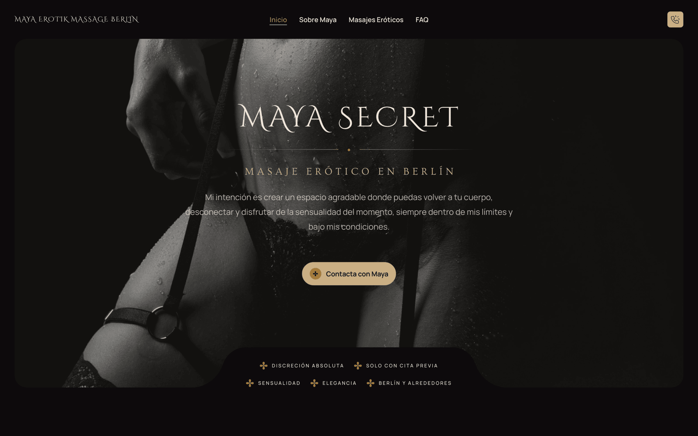

# Maya Secret — Erotic Massage Berlin

Website of **Maya Secret**, an independent erotic and tantric massage practice in Berlin. Home and hotel visits, by appointment only.

Live: **[www.mayaerotikmassage.com](https://www.mayaerotikmassage.com)**



## What it is

A static, multi-page site in four languages — German (primary, at the root), English, Spanish and Italian. Plain HTML, a handful of stylesheets and vanilla JS: **no bundler, no framework, no dependencies to install**. The only build step is a Python script that stamps the four language trees out of `src/` plus the string tables in `i18n/`. The markup started life as an Elementor theme and was flattened into static files; the CSS and JS written for this project sit on top of it.

- **Zero third-party requests.** No analytics, no CDN, no embeds, no cookies. Fonts, images, jQuery, GSAP, Lenis and Swiper are all self-hosted.
- **18+ age gate (JMStV).** `js/age-gate.js` runs from `<head>` and veils the page before first paint; the visitor self-declares and the answer is stamped in `localStorage` for 30 days. Paired with the `age-de-meta-label` meta tag German filters read. It is a §5 self-declaration, not an identity-checking AVS.
- **Nine service pages × four languages.** One folder per massage, named in its own language (`/massagen/nuru-massage/`, `/en/massages/nuru-massage/`, `/es/servicios/masaje-erotico-nuru/`, `/it/servizi/massaggio-nuru/`), all sharing `css/service.css`, the only stylesheet written from scratch.
- **`hreflang` across all 52 pages,** with German as `x-default`, a `DE · EN · ES · IT` switcher in the header, and `FAQPage` JSON-LD generated from the visible accordion of each page.
- **Motion that respects the visitor.** Lenis smooth scroll plus GSAP `ScrollTrigger`/`SplitText` for per-character text reveals and image wipes; the whole module returns early under `prefers-reduced-motion: reduce`.
- **CSS instead of JS where possible.** The "Masajes" mega menu with its hover photo panel is pure CSS, and so is the spotlight effect that restores colour under the pointer on grayscale photos (`@property` + a masked `backdrop-filter`).
- **Clean URLs.** `/about`, `/masajes`, `/servicios/masaje-erotico-nuru/` — the `.html` files stay on disk and Cloudflare resolves them extensionless.

## Layout

```
src/                    # templates: the 13 pages, Spanish text as translation keys
i18n/strings.es.json    # extracted strings (generated)
i18n/strings.{de,en,it}.tsv   # one translation per line, indexed
scripts/i18n_extract.py # src/ -> i18n/strings.es.json
scripts/i18n_build.py   # src/ + i18n/ -> the four language trees
scripts/faqjson.py      # FAQPage JSON-LD from each page's visible accordion

index.html              # German home (primary language, lives at the root)
ueber-maya.html         # erotische-massagen.html, faq.html
massagen/<massage>/     # nine German service pages
en/ · es/ · it/         # the other three trees, same shape, own file names
impressum.html          # legal pages: German only, shared by all languages
datenschutz.html
_redirects              # old Spanish root URLs -> /es/… (301, generated)
sitemap.xml             # all 52 URLs with hreflang alternates (generated)
css/app.css             # flattened theme CSS
css/theme-palettes.css  # "Noir Vino" palette — colour tokens only
css/service.css         # service page layout (hand-written)
css/mega-menu.css       # CSS-only mega menu
css/spotlight.css       # grayscale → colour under the cursor
css/app-late.css        # non-critical CSS, loaded at the end of <body>
js/age-gate.js          # 18+ gate
js/revoza-scroll.js     # Lenis + GSAP scroll choreography
js/svc-lightbox.js      # <dialog> lightbox for service photos
js/vendor/              # gsap, ScrollTrigger, SplitText, lenis
fonts/                  # self-hosted woff2 (Cinzel Decorative, Ovo, Manrope, Bricolage Grotesque)
imgs/                   # photography, favicons, open graph
wrangler.jsonc          # Cloudflare Workers Static Assets config
.github/workflows/      # push to main → pings the Cloudflare deploy hook
```

## Building the four languages

Edit copy in `src/` (Spanish — it doubles as the translation key) or in the language tables, then regenerate:

```bash
python3 scripts/i18n_extract.py   # only after adding or changing Spanish text
python3 scripts/i18n_build.py     # writes /, /en, /es, /it, _redirects, sitemap.xml
```

`i18n/strings.{de,en,it}.tsv` holds one `index<TAB>translation` line per string, in the order of `i18n/strings.es.json`; the build refuses to run if a line is missing or out of order. **Never edit the generated pages directly** — the next build overwrites them. `impressum.html` and `datenschutz.html` are hand-maintained and outside the build.

## Running it locally

No install:

```bash
python3 -m http.server 8080
```

That serves `index.html` but not the extensionless `/about`. For real clean-URL testing use `npx wrangler dev`, which applies the same `html_handling` rule as production.

The age gate stores its answer per origin — clear `localStorage` (or open a private window) to see it again.

## Deployment

Hosted on **Cloudflare Workers Static Assets**: no Worker script, no hosting plan — `wrangler.jsonc` serves the repository root as assets and claims both `mayaerotikmassage.com` and `www.mayaerotikmassage.com` as custom domains, creating the DNS records on deploy.

```bash
npx wrangler deploy
```

`.assetsignore` keeps repository-only files (`.git`, `inspiration/`, `wrangler.jsonc`, `docs/`, caches) out of the published bundle.

A push to `main` runs `.github/workflows/deploy.yml`, which pings the Cloudflare deploy hook stored in the `CF_DEPLOY_HOOK` secret — so merging to `main` is all a deploy takes.
